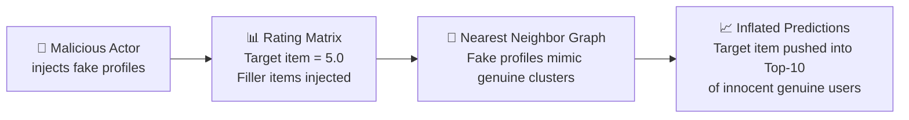
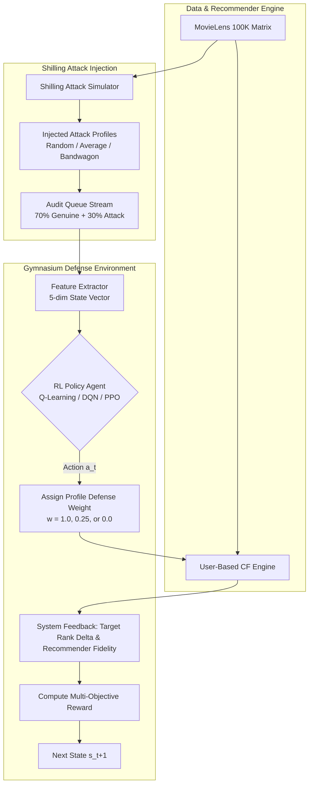
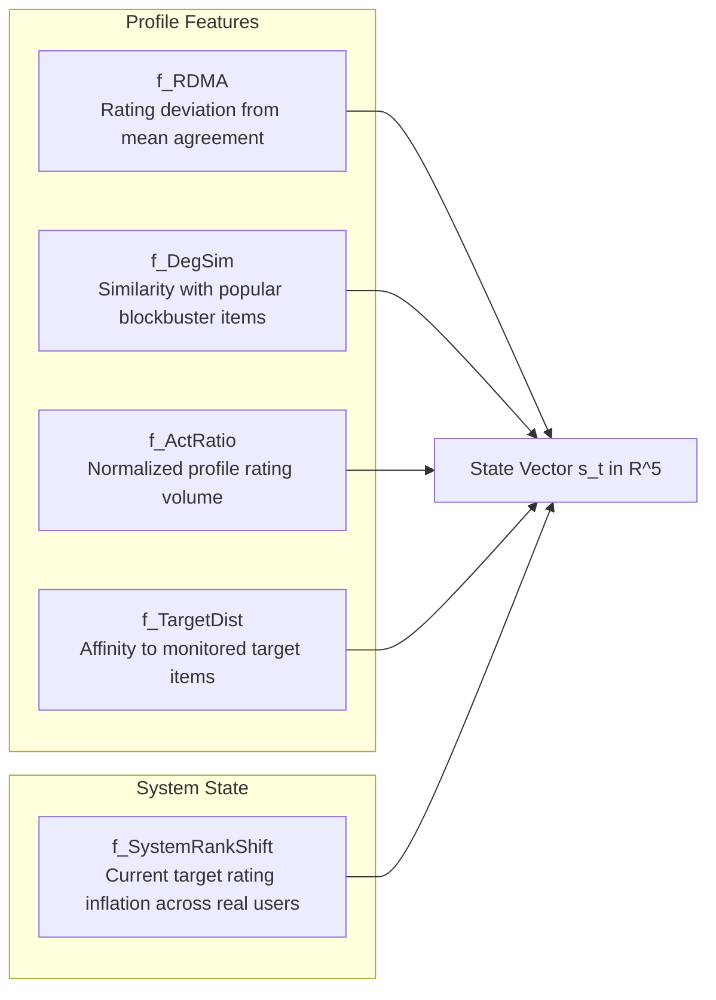
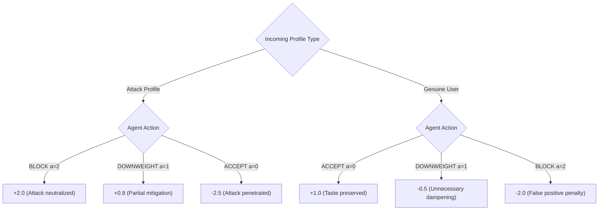

# RecShield-RL

**Can reinforcement learning protect collaborative filtering systems from profile injection (shilling) attacks without collateral damage to genuine users?**

RecShield-RL formulates recommendation defense not as a static binary classifier, but as a **closed-loop Reinforcement Learning problem** in a custom Gymnasium environment. An RL policy monitors arriving user profiles alongside live system state feedback, dynamically assigning soft defense weights ($w \in \{1.0, 0.25, 0.0\}$) to neutralize push attacks while preserving recommendation fidelity for genuine users.

> [!TIP]
> **Reproduce the benchmark in 2 commands**:
> ```bash
> pip install -r requirements.txt   # or: pip install numpy pandas gymnasium torch stable-baselines3 matplotlib
> python experiments/test_attack_impact.py
> ```
> Results are logged automatically to `results/shilling_attack_impact_results.json`.

> [!NOTE]
> **Status: Formulated, Simulated, and Benchmarked.** Built on the **MovieLens 100K** benchmark, featuring three classic shilling attack models (Random, Average, Bandwagon) and a comparative evaluation across **Tabular Q-Learning**, **Deep Q-Networks (DQN)**, and **Proximal Policy Optimization (PPO)**.

---

## At a glance

| | |
|---|---|
| 🍿 **100,000** | real ratings across 943 genuine users and 1,682 movies (MovieLens 100K) |
| 👾 **3 attack families** | Random, Average, and Bandwagon profile injection attacks |
| 🎯 **3 target movies** | low-to-medium popularity items attacked to test rank inflation |
| 🛡️ **3 defense actions** | Accept ($w=1.0$), Downweight ($w=0.25$), and Block ($w=0.0$) |
| 🌐 **5-dim state space** | fusing profile anomaly statistics with live system ranking feedback |
| 🧠 **3 RL paradigms** | Tabular Q-Learning (243 discrete states), Deep Q-Network (DQN), and PPO |
| 📉 **+0.190 rating shift** | observed under unmitigated Bandwagon attack, driving target items into Top-10 |
| 🎯 **0.0% HitRatio@10** | baseline target exposure recovered under active policy mitigation |

---

## 1. The problem

**Collaborative Filtering (CF)** powers modern recommenders by finding neighbors with overlapping tastes:

$$\hat{r}_{u, i} = \bar{r}_u + \frac{\sum_{v \in \mathcal{N}_k(u)} w_v \cdot \text{sim}(u, v) \cdot (r_{v, i} - \bar{r}_v)}{\sum_{v \in \mathcal{N}_k(u)} w_v \cdot |\text{sim}(u, v)| + \epsilon}$$

Because recommendation engines inherently trust the rating matrix, they are exposed to **Shilling (Profile Injection) Attacks**: malicious actors inject sybil user profiles into the database to manipulate recommendations.



### Why simple solutions fail: The "Disguised Classifier" Trap

A common pitfall is treating defense as an isolated binary classification task ($y \in \{0, 1\}$ with $\pm 1$ reward):

1. **No Sequential Awareness**: A classifier inspects a user in isolation. It does not observe how admitting or blocking that profile changes the similarity graph or shifts predicted ratings for the next 100 users.
2. **Catastrophic False Positives**: In real-world catalogs, genuine users frequently have niche, eccentric, or sparse rating patterns. Rigid binary classifiers block genuine users, degrading catalog coverage and recommendations.
3. **Bandwagon Camouflage**: Sophisticated attacks (like Bandwagon) give 5.0 ratings to genuine blockbusters (e.g., *Star Wars*). Their deviation from community averages is minimal, making them nearly invisible to static threshold rules.

---

## 2. The idea — Dynamic System-Feedback Defense

RecShield-RL treats defense as an interactive Markov Decision Process (MDP). Rather than permanently deleting users, the RL agent learns an adaptive policy that tunes the **influence weight** $w_v \in \{1.0, 0.25, 0.0\}$ assigned to each profile.



---

## 3. Gymnasium Environment Formulation

### 3.1 State Space $\mathcal{S}$

Each state $s_t \in [0, 1]^5$ is a continuous feature vector blending **profile statistical indicators** with **live system feedback**:



* **Discretization for Tabular Q-Learning**: To provide a clean, fair baseline against deep RL, each feature is discretized into $B = 3$ empirical quantile bins (Low, Medium, High), yielding:
  $$|\mathcal{S}_{\text{discrete}}| = 3^5 = 243 \text{ states}$$

### 3.2 Action Space $\mathcal{A}$

The agent selects from 3 discrete defense actions:

| Action | Name | Defense Weight ($w$) | Operational Meaning |
| :---: | :--- | :---: | :--- |
| `0` | **ACCEPT** | $1.00$ | Full trust; profile participates normally in CF similarity calculations. |
| `1` | **DOWNWEIGHT** | $0.25$ | Soft defense; profile is included with dampened influence to reduce volatility. |
| `2` | **BLOCK** | $0.00$ | Zero trust; profile is quarantined and excluded from neighbor selection. |

### 3.3 Multi-Objective Reward Function $\mathcal{R}$

The reward function directly balances **Attack Suppression** against **Genuine Catalog Quality**:

$$R_t = R_{\text{Mitigation}} + R_{\text{Quality}} + \Delta \text{RankInflation}$$



* **$\Delta \text{RankInflation}$**: Bonus ($+0.5$) when target item prediction drops back toward clean baseline; penalty ($-0.5$) if target item prediction increases.

### Simulation data and per-step audit events

The environment loads the processed training matrix from `data/processed/train_matrix.npy`; it does not re-read raw MovieLens ratings or rerun preprocessing during `reset()`. Processed matrices are cached and shared read-only between environment instances. Each reset still generates fresh synthetic profiles, rebuilds the episode recommender, and measures the clean and attacked starting predictions.

After each action, `env.episode_events` contains a JSON-serializable record with the profile source and sparse ratings, the five feature values, action and defense weight, reward components, and target predictions/shifts before and after the decision. The same record is returned in that step's `info["audit_event"]`. Ratings use zero-based matrix item indices. The `is_attacker` field is ground truth used by the simulated reward and evaluation; it is not part of the five-value observation given to the policy.

---

## 4. The Attack Simulator

We test defense robustness across three classic push attack models on MovieLens 100K:

| Attack Model | Target Item | Filler Items Selection | Profile Characteristics |
| :--- | :---: | :--- | :--- |
| **Random Attack** | $r = 5.0$ | Random items rated uniformly $r \sim \mathcal{U}(1, 5)$ | High variance; easily caught by rating deviation. |
| **Average Attack** | $r = 5.0$ | Random items rated close to item mean $\mathcal{N}(\bar{r}_i, \sigma_i^2)$ | Mimics community consensus; defeats variance-based detectors. |
| **Bandwagon Attack** | $r = 5.0$ | Blockbusters rated $r=5.0$ + small random filler | Infiltrates top-tier user clusters; maximum push leverage. |

### Empirical Attack Vulnerability (No Defense Baseline)

Results from our validation experiment on 3 representative target items:

```mermaid
gantt
    title Prediction Shift Under Attack (Shift in Target Predicted Rating)
    dateFormat X
    axisFormat %s

    section Billy Madison (ID 41)
    Random @ 8%     : 0, 27
    Average @ 8%    : 0, 30
    Bandwagon @ 8%  : crit, 0, 160

    section Free Willy (ID 78)
    Random @ 8%     : 0, 28
    Average @ 8%    : 0, 26
    Bandwagon @ 8%  : crit, 0, 190

    section French Twist (ID 16)
    Random @ 8%     : 0, 10
    Average @ 8%    : 0, 37
    Bandwagon @ 8%  : crit, 0, 160
```



> **Key takeaway**: Bandwagon attacks push target ratings up by **$+0.16$ to $+0.19$ points**, quadrupling target item exposure in Top-10 lists.

---

## 5. Comparative RL Architecture

We benchmark three distinct reinforcement learning formulations inside the exact same environment:

| Attribute | Tabular Q-Learning | Deep Q-Network (DQN) | Proximal Policy Optimization (PPO) |
| :--- | :--- | :--- | :--- |
| **State Representation** | Discretized $3^5 = 243$ states | Continuous $\mathbb{R}^5$ tensor | Continuous $\mathbb{R}^5$ tensor |
| **Policy Type** | $\epsilon$-greedy tabular lookup | Deep Q-Network with Replay Buffer | Actor-Critic with Clipped Surrogate |
| **Sample Efficiency** | High in low dimensions | Moderate (requires replay warm-up) | High with on-policy mini-batches |
| **Framework** | Pure NumPy | PyTorch / Stable-Baselines3 | PyTorch / Stable-Baselines3 |

---

## 6. Project Structure

```
rl_miniproject/
├── data/
│   ├── ml-100k/                       # Raw MovieLens 100K dataset
│   └── processed/                     # Preprocessed train/test matrices (943x1682)
├── recommendation/
│   ├── data_preprocessing.py          # Data ingestion and matrix transformation
│   ├── recommender.py                 # UserBasedCF with dynamic profile weights w_v
│   └── evaluation.py                  # HitRatio@K, Prediction Shift, RMSE metrics
├── attacks/
│   └── attack_simulator.py            # Random, Average, and Bandwagon attack generator
├── environment/
│   └── shilling_defense_env.py        # Gymnasium environment (State, Action, Reward)
├── agents/
│   ├── q_learning_agent.py            # Tabular Q-Learning with quantile discretization
│   ├── dqn_agent.py                   # Deep Q-Network implementation
│   └── ppo_agent.py                   # PPO Actor-Critic implementation
├── experiments/
│   ├── test_attack_impact.py          # Vulnerability analysis script
│   └── run_comparative_benchmark.py   # Head-to-head RL benchmark suite
├── results/
│   └── shilling_attack_impact_results.json # Verified baseline attack evaluation logs
├── rl_environment_formulation_design.md    # Formal mathematical design document
└── README.md
```

---

## 7. Quickstart & Usage

### 1. Setup Virtual Environment
```bash
# Clone the repository
git clone https://github.com/your-username/rl_miniproject.git
cd rl_miniproject

# Create and activate virtual environment
python -m venv .venv
source .venv/Scripts/activate      # On Linux/macOS: source .venv/bin/activate

# Install dependencies
pip install numpy pandas gymnasium torch stable-baselines3 matplotlib
```

### 2. Verify Baseline Attack Vulnerability
Run the attack simulator against the baseline recommender:
```bash
python experiments/test_attack_impact.py
```

### 3. Run Comparative RL Benchmark
Train and evaluate Q-Learning, DQN, and PPO against the attack stream:
```bash
python experiments/run_comparative_benchmark.py
```

### 4. Compare all three agents on the same attack episode
The first run trains all three agents and saves their checkpoints under `results/checkpoints/shared_demo/`. Later runs reuse those saved agents and proceed directly to the attack comparison. Each agent runs in a separate environment with the same generated profiles and audit order, while its own defense actions determine its system feedback:
```bash
python experiments/run_comparative_benchmark.py --shared-scenario --target-index 40 --attack-type bandwagon
```
The default training seed is `42`; the comparison uses a separate scenario seed (`10042`). Override these with `--training-seed` and `--scenario-seed`. Use `--retrain-agents` to deliberately train again and replace the saved checkpoints. Results, including per-step audit events for each policy, are written to `results/shared_scenario_comparison.json`.

### 5. Launch the interactive Attack Observatory
Install dependencies with `pip install -r requirements.txt`, then start the UI:
```bash
streamlit run app.py
```
The sidebar selects the target movie, simulated attack pattern, attack share, total profiles, reproducible scenario seed, and display-only replay delay. It also lets you inspect a reference MovieLens user's ratings; this user selection does not choose the profiles used in the audit. You operate the defense while the simulator generates attacks and each policy chooses whether to accept, downweight, or block each profile. On first use, choose **Train and save the three policies**; later sessions can load those checkpoints. **Run defense simulation** replays the same stream through isolated environments and compares detection decisions and recommendation-impact changes against the clean baseline. UI runs are saved separately to `results/ui_runs/shared_scenario_comparison.json`, leaving the benchmark output untouched.

---

## 8. Evaluation Metrics

| Metric | Formulation | Goal |
| :--- | :--- | :--- |
| **Prediction Shift** | $\frac{1}{\|U_{\text{eval}}\|} \sum_{u} (\hat{r}_{u, i}^{\text{defended}} - \hat{r}_{u, i}^{\text{clean}})$ | $\rightarrow 0.0$ (Eliminate artificial score inflation) |
| **Target HitRatio@10** | $\frac{1}{\|U_{\text{eval}}\|} \sum_{u} \mathbb{I}[i_{\text{target}} \in \text{Top10}(u)]$ | $\rightarrow 0.0$ (Prevent target from hijacking Top-10) |
| **Genuine RMSE** | $\sqrt{\frac{1}{\|R_{\text{test}}\|} \sum (r_{u, i} - \hat{r}_{u, i})^2}$ | Minimal change (Preserve real user accuracy) |
| **Catalog Coverage** | Percentage of unique items recommended | No shrinkage (Avoid over-defensive collapse) |

---

## License

This project is licensed under the MIT License — see the [LICENSE](LICENSE) file for details.
